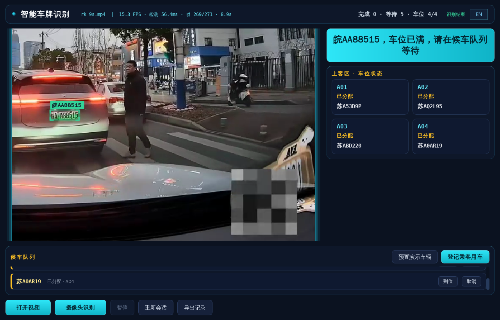

# Plate Recognition & Dispatch System

[中文](README.zh-CN.md)

This edge-AI application for Quectel Pi (RK3576) recognizes license plates and dispatches ride-hailing pickup spots. Play a real-world traffic video or plug in a USB camera: plate detection, corner-point rectification, character recognition and multi-frame confirmation all run on the on-board NPU in real time. Recognized plates then drive the full dispatch flow — registration, four-slot assignment, arrival, serving, timeout, cancellation and FIFO queue refill — with synchronized voice announcements. Completely offline.



## Features

- **Real-time plate recognition** — HyperLPR3 dual models (y5fu detector + rpv3 recognizer, RKNN fp16) on the RK3576 NPU, 14–18 FPS on 720p video
- **Blue & green plates** — 7-character standard plates and 8-character new-energy plates, province characters included
- **Multi-frame confirmation** — IoU tracking plus four gates (votes / ratio / confidence / length) reject truncated reads and false alarms
- **Automatic slot dispatch** — registered plates get A01–A04 slots automatically, with banner and voice "Plate, please go to A0X"
- **Arrival & serving management** — arrival, serving, timeout warning, cancellation and slot release in one flow
- **FIFO waiting queue** — new orders queue when all slots are taken and refill in order
- **Unregistered detection & make-up registration** — unknown plates are flagged automatically with one-key registration
- **Second pickup** — returning registered vehicles are served again without re-registration
- **Bilingual UI & voice** — one-key switch between Chinese and English, offline voice packs included
- **One-key demo mode** — a single click walks through the entire dispatch flow automatically
- **Record export** — recognition events (JSON/CSV), plate crops and dispatch logs written automatically at session end

## Technology Stack

- Python 3 + PySide6 (Qt) GUI with dark sci-fi QSS and monospace readouts
- HyperLPR3 models (y5fu / rpv3) converted to RKNN (fp16, no quantization), executed via ctypes against librknnrt on the NPU
- OpenCV video-file and V4L2 camera capture, perspective rectification using measured corner-point aspect ratios
- Offline voice built from edge-tts word tokens (province / letter / digit / phrase), played via PipeWire with ALSA fallback
- Go static launcher + self-extracting `.run` installer

## Hardware Requirements

| Item | Requirement |
|---|---|
| Board | Quectel Pi (RK3576, 6 TOPS NPU) |
| Camera (optional) | USB UVC camera (built-in demo videos also work) |
| Audio | Speaker or headset (follows system output route, Bluetooth works) |
| Storage | ~1 GB free for installation |

## Project Structure

```
├── code/                    # Application source
│   ├── main.py              # Entry point
│   ├── app.py               # UI, video loop, dispatch event rendering
│   ├── detector.py          # Plate detection (y5fu post-processing)
│   ├── reader.py            # Character recognition (rpv3 CTC decode)
│   ├── tracker.py           # Track association & confirmation gates
│   ├── dispatch.py          # Dispatch core (assign/arrival/timeout/queue/demo)
│   ├── voice_player.py      # Voice token concatenation & 3-level playback fallback
│   ├── session.py           # Session records and export
│   ├── rknn_backend.py      # RKNN NPU inference wrapper (ctypes)
│   ├── run.sh               # Launcher script (Wayland session discovery)
│   └── plate-recognition    # Double-click launcher (static Go ELF)
├── models/                  # Detector/recognizer ONNX + RKNN models
├── assets/voice/            # Offline voice token library (80 wavs)
├── materials/videos/        # 5 out-of-box demo videos
├── materials/demo/          # Three-part application demo video
└── tools/                   # Model conversion, TTS generation, packaging
```

## Quick Start

### 1. Get the installer

Download `plate-recognition-installer.run` (~137 MB, bundles the Python runtime, models, voice packs and demo videos) from the [Releases](https://github.com/Quectel-Pi/demo-ai-plate-watch-dispatch/releases) page.

### 2. Push it to the board

```bash
adb push plate-recognition-installer.run /home/q/
adb shell chown q:q /home/q/plate-recognition-installer.run
```

### 3. Install

```bash
# Normal user q (recommended) → ~/plate-rec
adb shell su - q -c '/home/q/plate-recognition-installer.run'

# or as root → /root/plate-rec
adb shell /home/q/plate-recognition-installer.run
```

### 4. Launch

Double-click `code/plate-recognition` in the file manager, or:

```bash
cd ~/plate-rec/code && ./run.sh
```

## Build from Source (optional, for developers)

> Regular users can simply download the `.run` installer from [Releases](https://github.com/Quectel-Pi/demo-ai-plate-watch-dispatch/releases) — this section is not needed.
> Packaging happens on an **x86 Linux host**; the board only installs and runs.

### 1. Clone the repo and check prerequisites

```bash
git clone https://github.com/Quectel-Pi/demo-ai-plate-watch-dispatch.git
cd demo-ai-plate-watch-dispatch

go version          # Go ≥ 1.18 (launcher cross-compile; the repo also ships a prebuilt ELF)
python3 --version && tar --version && xz --version
adb devices         # board connected
```

### 2. Build the Qt runtime (runtime/, not included in the repo)

The GUI depends on PySide6/Qt6 (aarch64, Python 3.13). Pull an aarch64 environment with micromamba and lay it out:

```bash
micromamba create -y -p ./rt-root -c conda-forge --platform linux-aarch64 \
    python=3.13 pyside6=6.11.2

mkdir -p runtime/py runtime/lib runtime/share
cp -a rt-root/lib/python3.13/site-packages/. runtime/py/          # PySide6 + shiboken6
( cd rt-root/lib && find . -maxdepth 1 -mindepth 1 ! -name 'python*' \
    -exec cp -a {} "$OLDPWD/runtime/lib/" \; )                    # Qt libs and dependency .so files
cp -a rt-root/share/. runtime/share/                             # Qt translations etc.
```

This `runtime/` works as-is (~1 GB untrimmed); see [TECH.md](TECH.md) § 9.3 for trimming it to 151 MB via a readelf NEEDED-closure pass. If the app is already installed on a board, the installed `runtime/` can be reused directly.

### 3. (Optional) Regenerate voice and models

The repo ships all artifacts; only needed for re-building them:

```bash
# Voice tokens (assets/voice/, 80 wavs): requires edge-tts + miniaudio
pip install edge-tts miniaudio
python3 tools/gen_voice.py

# Models (models/, ONNX already in the repo): requires rknn-toolkit2 2.3.2
# (opset 19, fp16, target rk3576) — details in TECH.md § 10
```

### 4. One-command packaging

```bash
bash tools/make_run_pack.sh
# Output: dist/plate-recognition-installer.run (~137 MB)
```

The script cross-compiles the Go launcher, assembles code/models/runtime/demo videos/voice, compresses with tar.xz and appends a self-extracting shell header.

### 5. Deploy to the board

```bash
adb push dist/plate-recognition-installer.run /home/q/
adb shell chown q:q /home/q/plate-recognition-installer.run
adb shell su - q -c '/home/q/plate-recognition-installer.run'
```

Double-click `plate-rec/code/plate-recognition` to launch. For acceptance checks see [Quick Start](#quick-start).

> **Iterating on code**: no need to repackage — push changed `code/*.py` straight to the
> install dir on the board (`adb push code/app.py /home/q/plate-rec/code/`) and they take effect.

## Usage

1. Press **登记乘客用车** to enter a plate, or **预置演示车辆** to register a preset batch
2. Press **打开视频** to play a video from `materials/videos/` (or connect a USB camera and press **摄像头识别**)
3. A registered plate is recognized → slot assigned automatically with banner and voice "Plate, please go to A0X"
4. Press **车辆到位** on the vehicle row → serving starts; press **接客完成** → slot released and the queue refills
5. Overdue vehicles turn red on the slot card and can be cancelled; the top bar shows live statistics

**Hands-free alternative**: press **预演模式** (or pass `--demo`) and the app demonstrates the whole dispatch flow by itself.

## FAQ

**Camera not detected?**

Check `ls /dev/video*` on the board and replug the USB camera; the bundled `materials/videos/` clips also work.

**Recognition inaccurate?**

Only complete reads (≥7 characters) are confirmed as events; back-lighting and severe blur reduce accuracy, frontal angles work best.

**No voice output?**

The app follows the system audio route. Check the output device in system settings; a Bluetooth headset works as well.

## Technical Notes

For model conversion (ONNX → RKNN), confirmation gate parameters, the dispatch event flow and the full pitfall log, see [TECH.md](TECH.md).
